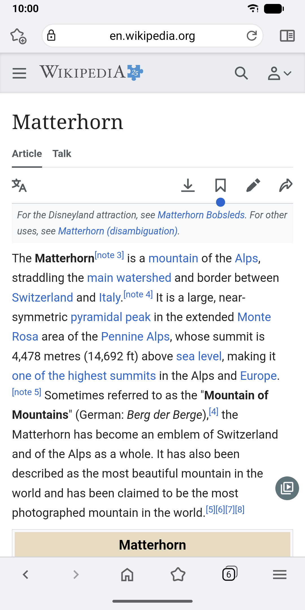
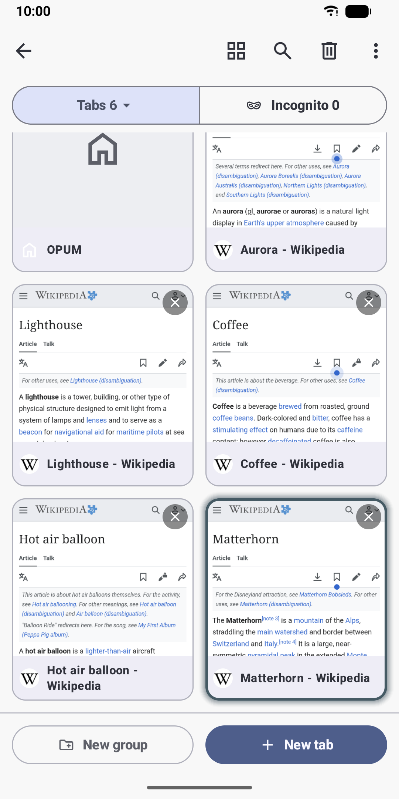
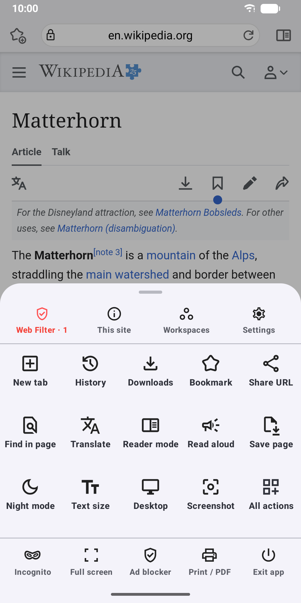
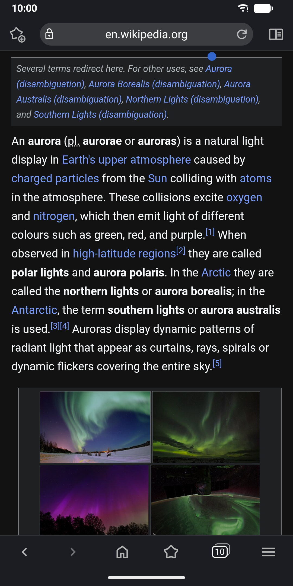
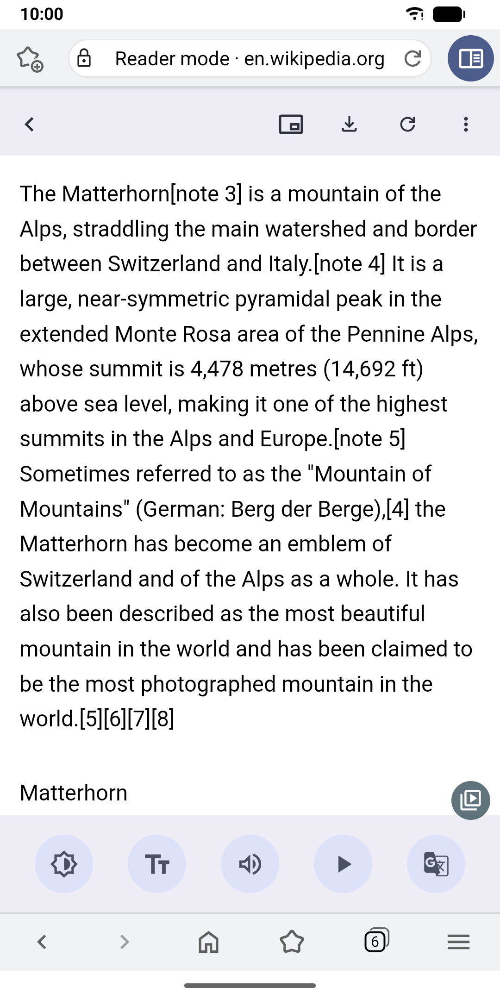
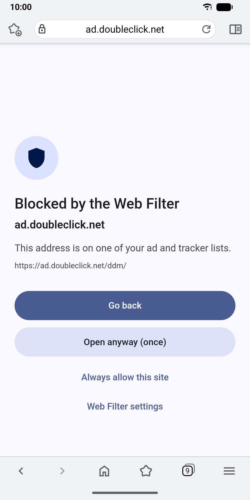
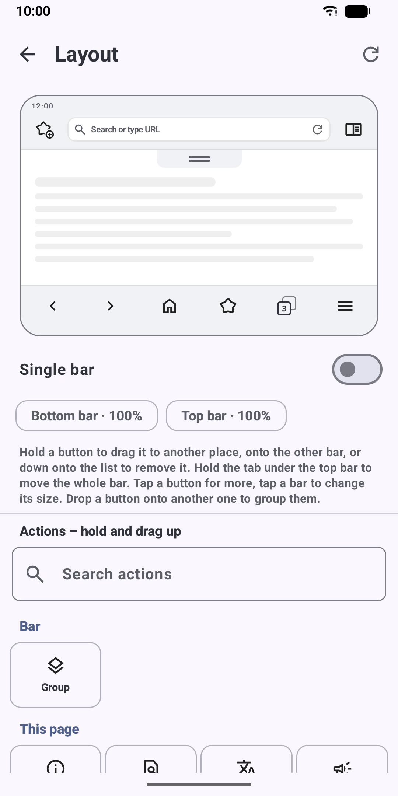
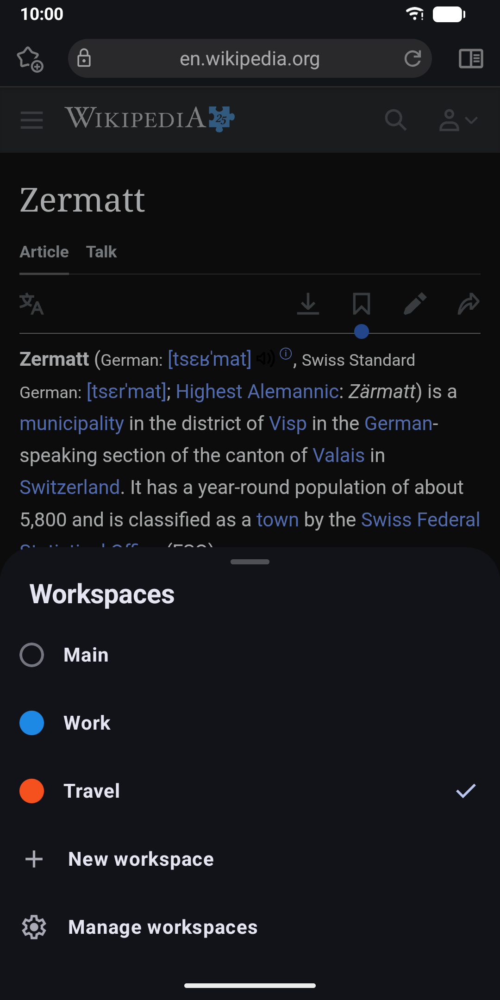

<p align="center">
  
</p>

<h1 align="center">OPUM Browser</h1>

<p align="center">
  <b>A fast, private web browser for Android that you shape to the way you hold your phone.</b><br>
  No account. No ads. No tracking. Open source.
</p>

<p align="center">
  <a href="LICENSE"></a>
  
  
  <a href="https://buymeacoffee.com/opum_labs"></a>
</p>

<p align="center">
  
  
  
  
</p>

## Why OPUM Browser

🔒 **Private by design.** What you do stays on your device: no account, no analytics, no crash reporting, no Google Play
Services. The Web Filter blocks ads, trackers, pop-ups and cookie banners before they load.

✋ **Made for your thumb.** Put the bars where you can reach them, choose your buttons and gestures, and edit the menu
until it fits the way you use your phone.

🗂️ **Tabs that stay tidy.** A tab overview that zooms smoothly, tab groups, workspaces for work and home, and tabs that
archive themselves when you stop using them.

## Features

<table>
<tr>
<td width="50%" valign="top">

**Private by design**
- Web Filter for ads, trackers, pop-ups, cookie banners and overlays, with the filter lists you choose (EasyList,
  AdGuard and more), built on [adblock-rust](https://github.com/brave/adblock-rust)
- A clear page when the Web Filter blocks a site, with one tap to go back or allow it
- Incognito mode with its own tabs and an optional lock
- App lock with fingerprint, face or PIN
- Encrypted backups, protected by a password only you know
- Bookmark sync with Chrome, Firefox, Edge and Brave through [floccus](https://floccus.org), on your own server:
  WebDAV (Nextcloud files, a NAS), S3, Git or Nextcloud Bookmarks, optionally encrypted, one setup per workspace
- Import and export of bookmarks (HTML) and passwords (CSV) in the formats of the other browsers

**Yours to shape**
- Bars at the top or the bottom, your own buttons and button groups
- An editable menu with a quick bar
- Gestures on the screen edges for back, forward and switching tabs
- Light, dark and dark web pages; wallpaper colours or your own colour, text size and font
- Every setting can be found with the settings search

</td>
<td width="50%" valign="top">

**Tabs that stay tidy**
- Tab overview as carousel, grid, list or stack, with tab groups
- Workspaces: separate sets of tabs and logins
- Throw a tab away with a flick, undo when you close one by mistake
- Close duplicates and old tabs in one go

**Read, watch, listen**
- Reader mode, page and text translation, read aloud
- Video helpers: full-screen controls, speed, picture-in-picture, background playback

**Handy tools**
- Screenshots in one tap, also of whole pages
- QR code scanner in the address bar
- Desktop sites with one switch
- Download manager with pause, resume and notifications
- Save pages, print to PDF, viewers for images, PDF and text

</td>
</tr>
</table>

<p align="center">
  
  
  
  
</p>

Works on phones and tablets, in portrait and landscape, with large text, right-to-left languages and screen readers.

## Privacy

The app has no account, no analytics, no ads and no crash reporting. Bookmark sync, if you set it up, talks only to
the server you enter. The privacy policy and terms are in
[`app/src/main/assets/notice/`](app/src/main/assets/notice/).

## Support

OPUM Browser is free and has no ads. If it is useful to you, you can
[buy the developer a coffee](https://buymeacoffee.com/opum_labs) ☕. The link is also in the app under Settings > About.

## For developers

<details>
<summary><b>Requirements and building</b></summary>

- Android 12L (API 32) or newer; targets API 37
- To build: Android Studio (its bundled JDK 17+ is enough), Android SDK 37

```bash
git clone https://github.com/OPUM-LABS/OPUM-Browser.git
cd OPUM-Browser
./gradlew :app:assembleDebug
```

The APK ends up in `app/build/outputs/apk/debug/` (`opum_browser-v<version>-debug.apk`).

| Build type | Package | Purpose |
|---|---|---|
| `debug` | `ch.opumlabs.opumbrowser` | everyday development |
| `release` | `ch.opumlabs.opumbrowser` | store builds (R8, shrunk resources); signed when `keystore.properties` exists |
| `qa` | `…opumbrowser.qa` | release code signed with the debug key, installs next to the app; for stability runs and benchmarks |
| `uitest` | `…opumbrowser.uitest` | target of the instrumented tests, so they never touch an installed app's data |

**Signed release:** copy `keystore.properties.example` to `keystore.properties` (git-ignored), fill it in, then:

```bash
./gradlew :app:bundleRelease     # Google Play (AAB)
./gradlew :app:assembleRelease   # APK
```

See [RELEASE.md](RELEASE.md) for the full release checklist.

</details>

<details>
<summary><b>Tests</b></summary>

```bash
./gradlew :app:testDebugUnitTest             # JVM unit tests
./gradlew :app:connectedUitestAndroidTest    # instrumented tests on a running emulator or device
```

More tools for the emulator:
- [tools/monkey](tools/monkey/README.md): random touch and swipe runs, also on the release code (`qa`)
- [tools/ui-smoke](tools/ui-smoke/README.md): opens the main screens, takes screenshots and checks the crash log
- [baselineprofile](baselineprofile/README.md): regenerates the baseline profile and runs the benchmarks

</details>

<details>
<summary><b>Project layout</b></summary>

| Path | Contents |
|---|---|
| `app/src/main/java/com/mycompany/app/` | the app (Kotlin, Compose for the newer screens) |
| `app/src/main/java/com/mycompany/app/web/` | browser activity, WebView, tabs, page handling |
| `app/src/main/java/com/mycompany/app/web/filter/` | Web Filter (adblock-rust bridge, cosmetic filtering) |
| `app/src/main/java/com/mycompany/app/ui/` | Compose UI: browser chrome, settings, onboarding, theme |
| `app/src/main/java/com/mycompany/app/pref/store/` | settings stores |
| `app/src/main/java/com/mycompany/app/data/sync/` | bookmark sync with floccus: XBEL file, encryption, merge, WebDAV / S3 / Git / Nextcloud (plain Kotlin, unit tested) |
| `app/src/main/java/com/mycompany/app/sync/` | bookmark sync on the phone: settings, bookmark rows, when it runs |
| `app/src/main/assets/filter/` | built-in filter lists, site fixes and uBlock Origin resources |
| `native/adblock-jni/` | Rust JNI bridge to adblock-rust ([README](native/adblock-jni/README.md)) |
| `tools/ubo-resources/` | builds the uBlock Origin resources and site fixes ([README](tools/ubo-resources/README.md)) |
| `fastlane/metadata/` | store listing texts and screenshots |

The filter engine (`libopumadblock.so` in `app/src/main/jniLibs/`) is checked in, so a normal build needs no Rust
toolchain. To rebuild the filter engine after changing `native/adblock-jni`, run `native/adblock-jni/build.sh` (needs
Rust and `cargo-ndk`).

</details>

<details>
<summary><b>Third-party licences</b></summary>

The app uses AndroidX, Jetpack Compose, Media3, Glide, jsoup, Gson, OkHttp, JGit, Readability, zip4j, ZXing, adblock-rust and
others.
Their licence texts are shipped in `app/src/main/assets/license/` and shown in the app under Settings > About > Open
source licenses.

</details>

## License

OPUM Browser is free software: you can redistribute it and/or modify it under the terms of the
[GNU General Public License](LICENSE) as published by the Free Software Foundation, either version 3 of the License, or
(at your option) any later version.

It is distributed in the hope that it will be useful, but WITHOUT ANY WARRANTY; without even the implied warranty of
MERCHANTABILITY or FITNESS FOR A PARTICULAR PURPOSE. See the GNU General Public License for more details.

SPDX-License-Identifier: `GPL-3.0-or-later`

---

<p align="center">© OPUM-Labs, Switzerland</p>
